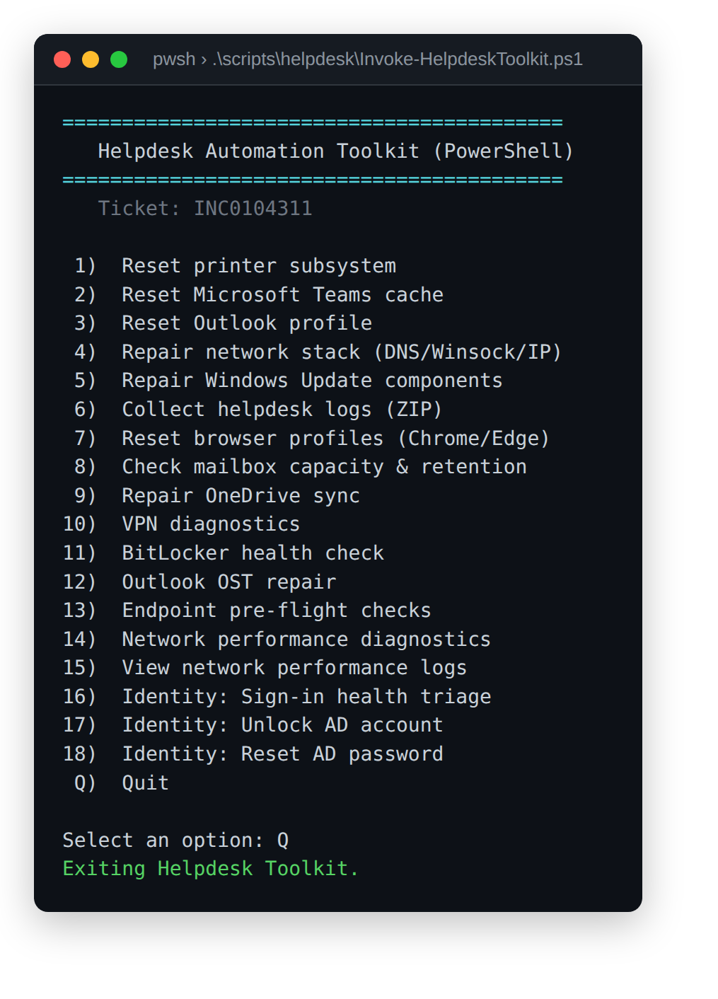
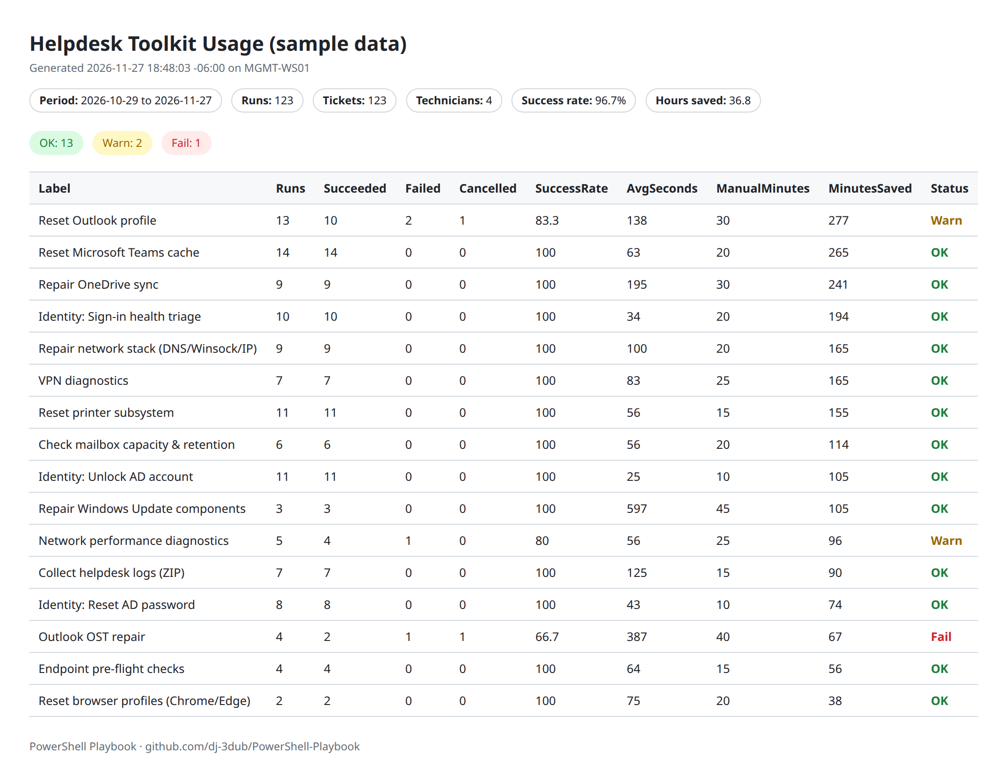
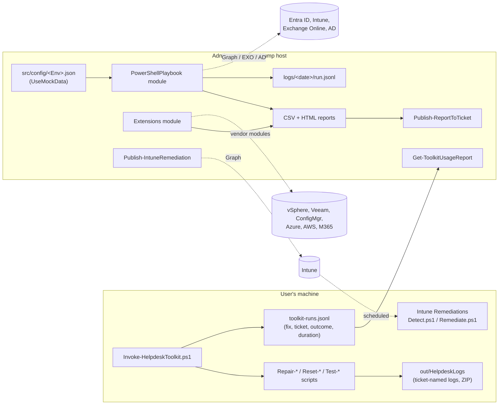
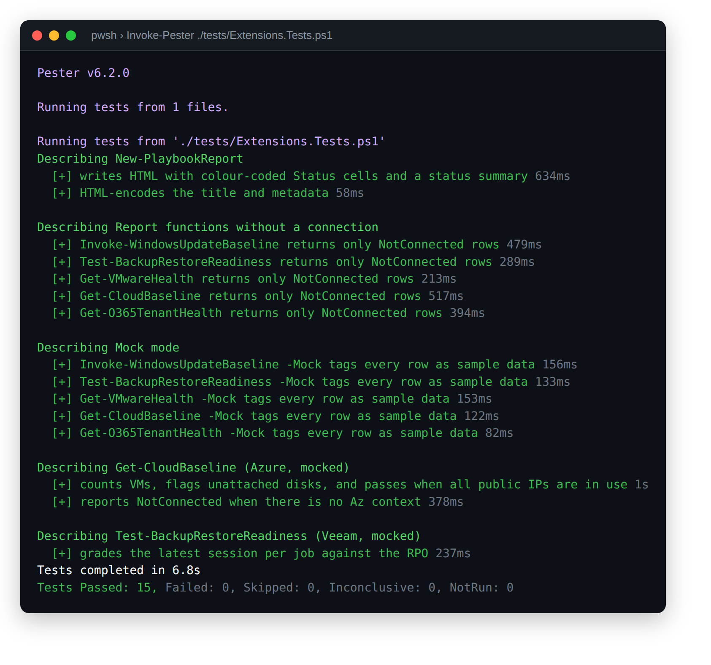

# PowerShell Playbook

[](https://github.com/dj-3dub/PowerShell-Playbook/actions/workflows/ci.yml)

[](LICENSE)

PowerShell automation for the work that fills a service desk queue and an infrastructure team's week:
repeatable endpoint repairs, user offboarding, Intune remediations that fix problems before anyone calls,
and health reports across Active Directory, Entra ID, Intune, Exchange Online, VMware, Azure and AWS.
It also measures itself: every helpdesk fix is logged so you can report success rates and hours saved.

It is built the way production tooling should be: every state-changing action supports `-WhatIf`,
reports never fabricate data, everything runs on both Windows PowerShell 5.1 and PowerShell 7,
and every change is linted and tested on Windows and Linux in CI.


<sub>Real output recorded from this repo: an Intune baseline dry run, the toolkit usage report, and the offboarding test suite.</sub>

---

## What's inside

| Component | Path | What it is for |
|---|---|---|
| **Helpdesk Toolkit** | `scripts/helpdesk/` | Menu-driven first-line fixes and diagnostics, run on the user's machine; every run is logged |
| **Intune Remediations** | `remediations/` | Detect/fix script pairs Intune runs on every device on a schedule |
| **`PowerShellPlaybook` module** | `src/` | Offboarding, identity, security and endpoint reporting (AD, Entra ID, Intune, Exchange Online, Windows), toolkit usage metrics |
| **`PowerShell-Playbook.Extensions` module** | `src/` | Infrastructure and cloud health (patching, backups, vSphere, Azure/AWS, Microsoft 365) |
| **Automation scripts** | `scripts/automation/`, `scripts/` | Standalone jobs: bulk user onboarding, standard software builds, AD exports, endpoint hardening |

### Helpdesk Toolkit

`Invoke-HelpdeskToolkit.ps1` is a numbered menu over these scripts; each can also be run on its own.
It asks for the ticket ID once per session.



| Repairs | Diagnostics | Identity |
|---|---|---|
| Printer spooler reset | Endpoint pre-flight (OS, disk, memory, network, events) | Sign-in health triage (AD, optional Entra) |
| Teams cache (new and classic Teams) | Network performance (link speed, latency, packet loss) | Unlock AD account |
| Outlook profile reset, OST scan/rebuild | VPN connectivity and routing | Reset AD password |
| Network stack (DNS, Winsock, IP) | BitLocker and TPM status | |
| Windows Update components | Mailbox quota and retention policy | |
| Chrome/Edge profile cache | Log bundle (ZIP, ticket-ID named) | |
| OneDrive sync | | |

Every fix run through the menu appends one JSON line to `out/HelpdeskLogs/toolkit-runs.jsonl`: fix, ticket,
technician, duration and outcome (Success / Failed / Cancelled). See [Measuring impact](#measuring-impact).

### Offboarding

```powershell
Invoke-UserOffboarding -Identity jdoe -TicketId CHG0012345 -WhatIf      # full plan, nothing changed
Invoke-UserOffboarding -Identity jdoe -TicketId CHG0012345 -DisabledOU 'OU=Disabled Users,DC=corp,DC=local'
Undo-UserOffboarding  -SnapshotPath .\reports\Offboarding-jdoe-CHG0012345-....snapshot.json
```

1. **Snapshot.** Before changing anything, it writes a JSON snapshot of the account: groups, OU, description, enabled state and mailbox settings.
2. **Security steps first:**
   - disable the AD account
   - reset the password to a random value nobody knows
   - revoke Entra ID sessions
3. **Clean-up:**
   - stamp the AD description with the date, ticket and operator
   - remove group memberships
   - move the account to the disabled OU
4. **Hand-over:**
   - convert the mailbox to shared, with an auto-reply, hidden from the address book
   - give the manager Full Access to the mailbox and access to the OneDrive

How it behaves:
- **Every step is confirmable.** Each goes through `-WhatIf`/`-Confirm`.
- **Missing connections don't fail the run.** A step whose cloud connection is missing is marked Skipped.
- **One failure doesn't stop the rest.** A failed step is recorded and the remaining steps still run.
- **Undo restores the snapshot.** `Undo-UserOffboarding` puts back everything recorded in it.

### `PowerShellPlaybook` module

| Command | Purpose |
|---|---|
| `Invoke-UserOffboarding` / `Undo-UserOffboarding` | Leaver workflow across AD, Entra ID, Exchange Online and OneDrive, with snapshot-based undo |
| `Get-ToolkitUsageReport` | Helpdesk Toolkit runs, success rate per fix and estimated hours saved |
| `Get-InactiveAdAccounts` | Users with no logon in N days |
| `Send-PasswordExpiryNotifications` | Builds per-user password-expiry notices and a summary (preview only; delivery is on the roadmap) |
| `Get-ConditionalAccessReport` | Entra ID Conditional Access policies: state, scope, controls |
| `Get-ExchangeHygieneReport` | Per-mailbox external forwarding, litigation hold, archive, quota |
| `Invoke-IntuneBaseline` | Intune compliance and stale check-ins; `-Enforce` triggers a device sync |
| `Get-LocalAdminAudit` | Local Administrators membership against an allow-list, local or remote |
| `Get-DefenderStatus` | Defender AV health and signature age |
| `Get-CertificateExpiry` | Certificates expiring within N days |
| `Get-ServerRoleFeatureInventory` | Installed Windows Server roles and features |
| `Invoke-WinGetBaseline` | Audit or install a WinGet package baseline |
| `Export-SupportBundle` | System facts, services, events and network state, zipped |
| `New-WinServerVmFromTemplate` | Clone a Windows Server VM in vSphere, add 4 NICs, build two in-guest NIC teams |

`Get-ConditionalAccessReport`, `Get-ExchangeHygieneReport` and `Invoke-IntuneBaseline` read
`src/config/<Environment>.json`. `Dev` uses sample data; `Test` and `Prod` query the live tenant.

### `PowerShell-Playbook.Extensions` module

| Command | Checks |
|---|---|
| `Invoke-WindowsUpdateBaseline` | Patch compliance from Intune (Graph), ConfigMgr (SMS provider) or the local Windows Update Agent |
| `Test-BackupRestoreReadiness` | Latest Veeam session per job against a recovery point objective |
| `Get-VMwareHealth` | Host connection state, datastore free space, snapshot age |
| `Get-CloudBaseline` | Azure unattached disks and idle public IPs; AWS unattached volumes and old snapshots |
| `Get-O365TenantHealth` | Unified audit log, modern auth, auto-forwarding, external forwarders, SharePoint sharing level |
| `Publish-ReportToTicket` | Attach any report to a ticket through a REST API |

Each returns rows graded **OK / Warn / Fail** against configurable thresholds, writes CSV and HTML,
and accepts `-Mock` for sample data.

<p>
  
  
</p>

<sub>Screenshots show real output from this repo run with <code>-Mock</code>; rows are tagged <code>Source = Mock</code> and titles say "sample data".</sub>

### Intune Remediations

Detection and remediation pairs in [`remediations/`](remediations/README.md), published to Intune with
`Publish-IntuneRemediation.ps1` (Microsoft Graph, idempotent by display name):

| Remediation | Detects | Fixes |
|---|---|---|
| `LowDiskSpace` | System drive under 10% / 10 GB free | Clears temp, Windows Update and Delivery Optimization caches (old files only) |
| `TeamsCacheSize` | New Teams cache over 1 GB | Clears it only while Teams is closed |
| `TimeSync` | W32Time stopped, no time source, or skew over 60 s | Restores domain/NTP sync and forces a resync |
| `StaleWindowsUpdate` | No successful update in 35 days or update services disabled | Re-enables the services and triggers a scan |

---

## Measuring impact

`Get-ToolkitUsageReport` turns the toolkit's run log into numbers a service desk manager cares about. For each fix it shows:
- runs, success rate and average duration
- **minutes saved**, against a per-fix manual-effort baseline you can tune (`src/config/helpdesk-baselines.json`)

Fixes that fail often are flagged Warn or Fail, so you know which automation needs work.

```powershell
Get-ToolkitUsageReport -Since (Get-Date).AddDays(-30)
```



<sub>Generated with <code>-Mock</code> (deterministic sample data). Against a real run log, the same report shows your team's numbers.</sub>

---

## Quick start

No tenant, domain or vCenter is needed to try it.

```powershell
git clone https://github.com/dj-3dub/PowerShell-Playbook.git
cd PowerShell-Playbook

# Infrastructure and cloud reports with sample data
Import-Module ./src/PowerShell-Playbook.Extensions.psd1
$r = Get-VMwareHealth -Server vcsa01.corp.example.com -Mock
Invoke-Item $r.Html                     # ./out/<date>/Get-VMwareHealth/...

# Identity and security reports (Dev config = sample data)
Import-Module ./src/PowerShellPlaybook.psd1
Get-ConditionalAccessReport -Environment Dev
Invoke-IntuneBaseline -Environment Dev -Enforce -WhatIf
(Get-ToolkitUsageReport -Mock).Totals

# Helpdesk menu (Windows)
.\scripts\helpdesk\Invoke-HelpdeskToolkit.ps1
```

Against real systems, connect first with the vendor's own cmdlet, then drop `-Mock` or use `-Environment Prod`:

```powershell
Connect-MgGraph -Scopes Policy.Read.All, DeviceManagementManagedDevices.Read.All
Get-ConditionalAccessReport -Environment Prod
Invoke-IntuneBaseline -Environment Prod

Connect-AzAccount
Get-CloudBaseline -Provider Azure
```

Every command has help: `Get-Help Get-CloudBaseline -Full`.

---

## How it fits together



---

## Design decisions

**Safe by default.** Everything that changes state supports `-WhatIf` and `-Confirm`, and tests check that
`-WhatIf` changes nothing. Repairs are as narrow as possible. For example, the Teams reset clears only the
documented cache folders and leaves the install folder and the Outlook add-in alone, and the Windows Update
reset renames its cache folders rather than deleting them. Offboarding snapshots the account first so it can
be undone, and the Windows hardening scripts have `-Revert`. Scripts exit non-zero on failure, so RMM tools,
Intune and scheduled tasks can tell a failed run from a successful one.

**Never invent data.** A report either queries the live system or says it could not
(`Status = NotConnected`, with the command to fix it). Sample data appears only when explicitly requested
(`-Mock`, or `UseMockData` in config) and is labelled in every row and in the report title.

**Credentials stay out of the code.** Functions reuse the vendor module's existing session
(`Connect-MgGraph`, `Connect-ExchangeOnline`, `Connect-AzAccount`, `Connect-VIServer`), so MFA, certificate
auth and managed identity all work unchanged. Bulk user creation generates a unique random password per
account, requires a change at first logon, and never writes generated passwords to disk.

**Runs where the tickets are.** Stock Windows endpoints ship Windows PowerShell 5.1, so all code is
5.1-compatible. CI enforces this with `PSUseCompatibleSyntax`.

**Fix it before the ticket.** Recurring issues (disk space, Teams cache, clock drift, stalled updates) are
handled fleet-wide by Intune Remediations. Those scripts are conservative by design: they never close an app
the user is in, and they leave heavy repairs to a technician.

**Measure it.** Every toolkit fix is logged, so the value of the automation is a report, not an anecdote.

**Readable output.** Every report in both modules comes from one shared builder (`src/Shared`). They share a
status model (OK / Warn / Fail), colour-coded HTML and a CSV each, and the logs are JSON Lines that can go
straight to a SIEM.

---

## Testing and CI

```text
make test          # PSScriptAnalyzer + full Pester suite
make lint          # PSScriptAnalyzer only
./Run-Tests.ps1    # same, without make
```



GitHub Actions runs on **Windows and Ubuntu** for every pull request:

- **PSScriptAnalyzer** over `src/`, `scripts/` and `remediations/` with shared settings (`PSScriptAnalyzerSettings.psd1`); errors fail the build
- **Windows PowerShell 5.1 syntax compatibility** check across the repo
- **Pester** (about 230 tests):
  - Every PowerShell file parses.
  - Every exported command and hardening script has help.
  - Manifests match the code.
  - No script has a switch that defaults to on.
  - Behavior tests use Pester mocks in place of AD, Graph, Exchange Online, SharePoint, Azure, Veeam, Windows services, `w32tm`, Windows Update COM and user-profile paths, so the live code paths run without real infrastructure. Examples:
    - offboarding under `-WhatIf` changes nothing
    - undo restores every recorded group
    - the Teams remediation waits while Teams is open
    - the usage report's time-saved maths
- Test runs write only to Pester's `TestDrive`, never into the repo

---

## Repository layout

```text
src/
  PowerShellPlaybook.psd1/.psm1          Core module (exports src/Public/*)
  PowerShell-Playbook.Extensions.*       Infrastructure and cloud module
  Public/  Private/  config/             Exported commands, helpers, per-environment config and baselines
  Shared/                                Report and CSV helpers used by both modules
scripts/
  helpdesk/                              Helpdesk Toolkit menu and its scripts
  automation/                            Standalone jobs (onboarding, builds, repairs)
  *.ps1                                  AD export, Windows 11 hardening, module staging
remediations/                            Intune detection/remediation pairs and their publisher
config/                                  Software build and app-removal policies
tests/                                   Pester suite
docs/                                    Script notes and screenshots
```

Other automation scripts are described in [docs/automation-scripts.md](docs/automation-scripts.md).

## Requirements

- Windows PowerShell 5.1 or PowerShell 7.4+. The reports and tests also run on Linux and macOS.
- Live mode needs the vendor module for what you query: `Microsoft.Graph.*`, `ExchangeOnlineManagement`,
  `ActiveDirectory` (RSAT), `VCF.PowerCLI`, `Az.*`, `AWS.Tools.EC2`, or Veeam B&R.
  `scripts/Install-ProviderModules.ps1` checks for them and installs any that are missing (current user scope).
- Helpdesk repairs need Windows, and most need an elevated session.

## Roadmap

- Replace in-guest LBFO teaming in `New-WinServerVmFromTemplate` with Switch Embedded Teaming for Server 2022+
- Email delivery for `Send-PasswordExpiryNotifications` (Microsoft Graph `Send-MgUserMail`)
- GPO / RSoP troubleshooting in the Helpdesk Toolkit
- Publish the modules to an internal PowerShell repository from CI on tagged releases
- Feed Intune remediation results (Graph `deviceHealthScriptStates`) into the usage report

## License

[MIT](LICENSE)

## Author

**Tim Heverin** · Systems & Infrastructure Engineering · Chicago, IL ·
GitHub: [dj-3dub](https://github.com/dj-3dub)
