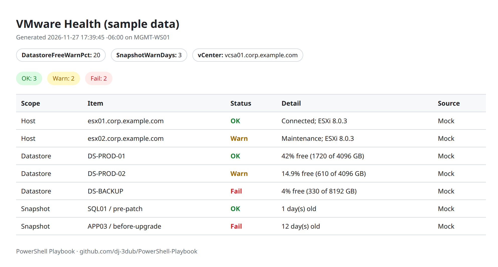
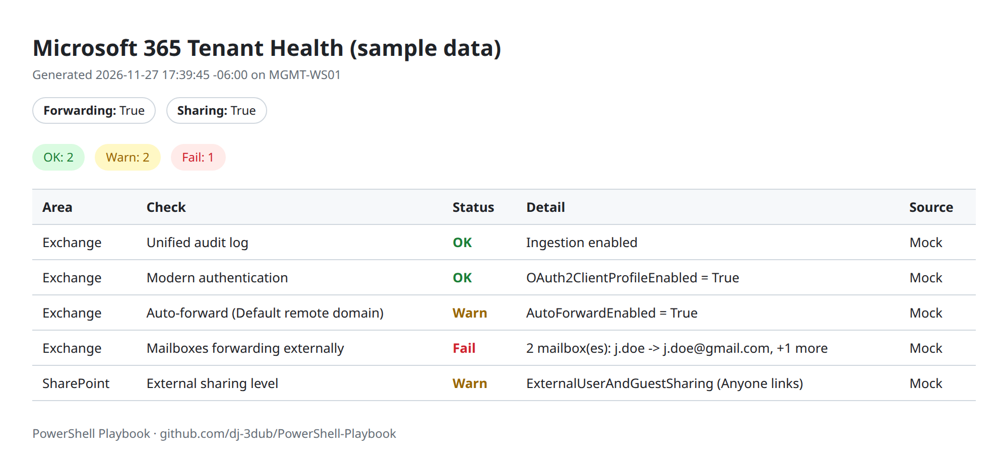
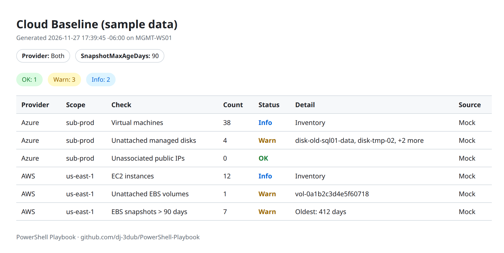
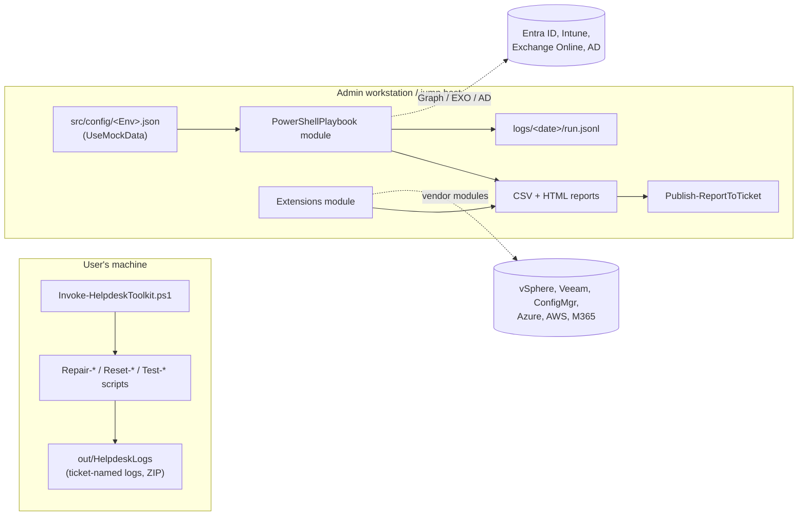

# PowerShell Playbook

[](https://github.com/dj-3dub/PowerShell-Playbook/actions/workflows/ci.yml)

[](LICENSE)

PowerShell automation for the work that fills a service desk queue and an infrastructure team's week:
repeatable endpoint repairs, identity triage, and health reports across Active Directory, Entra ID, Intune,
Exchange Online, VMware, Azure and AWS.

It is built the way production tooling should be: every state-changing action supports `-WhatIf`,
reports never fabricate data, everything runs on both Windows PowerShell 5.1 and PowerShell 7,
and every change is linted and tested on Windows and Linux in CI.

<p>
  
  &nbsp;
  
</p>

---

## What's inside

| Component | Path | What it is for |
|---|---|---|
| **Helpdesk Toolkit** | `scripts/helpdesk/` | Menu-driven first-line fixes and diagnostics, run on the user's machine |
| **`PowerShellPlaybook` module** | `src/` | Identity, security and endpoint reporting (AD, Entra ID, Intune, Exchange Online, Windows) |
| **`PowerShell-Playbook.Extensions` module** | `src/` | Infrastructure and cloud health (patching, backups, vSphere, Azure/AWS, Microsoft 365) |
| **Automation scripts** | `scripts/automation/`, `scripts/` | Standalone jobs: bulk user onboarding, standard software builds, AD exports, endpoint hardening |

### Helpdesk Toolkit

`Invoke-HelpdeskToolkit.ps1` is a numbered menu over these scripts; each can also be run on its own.

| Repairs | Diagnostics | Identity |
|---|---|---|
| Printer spooler reset | Endpoint pre-flight (OS, disk, memory, network, events) | Sign-in health triage (AD, optional Entra) |
| Teams cache (new and classic Teams) | Network performance (link speed, latency, packet loss) | Unlock AD account |
| Outlook profile reset, OST scan/rebuild | VPN connectivity and routing | Reset AD password |
| Network stack (DNS, Winsock, IP) | BitLocker and TPM status | |
| Windows Update components | Mailbox quota and retention policy | |
| Chrome/Edge profile cache | Log bundle (ZIP, ticket-ID named) | |
| OneDrive sync | | |

Diagnostic and identity scripts log to `out/HelpdeskLogs/`, with the ticket ID in the file name when one is passed (`-TicketId INC12345`).

### `PowerShellPlaybook` module

| Command | Purpose |
|---|---|
| `Get-InactiveAdAccounts` | Users with no logon in N days |
| `Send-PasswordExpiryNotifications` | Builds per-user password-expiry notices and a summary (preview only; delivery is on the roadmap) |
| `Get-ConditionalAccessReport` | Entra ID Conditional Access policies: state, scope, controls |
| `Get-ExchangeHygieneReport` | Per-mailbox external forwarding, litigation hold, archive, quota |
| `Invoke-IntuneBaseline` | Intune compliance and stale check-ins; `-Enforce` triggers a device sync |
| `Get-LocalAdminAudit` | Local Administrators membership against an allow-list, local or remote |
| `Get-DefenderStatus` | Defender AV health and signature age |
| `Get-CertificateExpiry` | Certificates expiring within N days |
| `Get-ServerRoleFeatureInventory` | Installed Windows Server roles and features |
| `Invoke-WinGetBaseline` | Audit or install a WinGet package baseline |
| `Export-SupportBundle` | System facts, services, events and network state, zipped |
| `New-WinServerVmFromTemplate` | Clone a Windows Server VM in vSphere, add 4 NICs, build two in-guest NIC teams |

`Get-ConditionalAccessReport`, `Get-ExchangeHygieneReport` and `Invoke-IntuneBaseline` read
`src/config/<Environment>.json`. `Dev` uses sample data; `Test` and `Prod` query the live tenant.

### `PowerShell-Playbook.Extensions` module

| Command | Checks |
|---|---|
| `Invoke-WindowsUpdateBaseline` | Patch compliance from Intune (Graph), ConfigMgr (SMS provider) or the local Windows Update Agent |
| `Test-BackupRestoreReadiness` | Latest Veeam session per job against a recovery point objective |
| `Get-VMwareHealth` | Host connection state, datastore free space, snapshot age |
| `Get-CloudBaseline` | Azure unattached disks and idle public IPs; AWS unattached volumes and old snapshots |
| `Get-O365TenantHealth` | Unified audit log, modern auth, auto-forwarding, external forwarders, SharePoint sharing level |
| `Publish-ReportToTicket` | Attach any report to a ticket through a REST API |

Each returns rows graded **OK / Warn / Fail** against configurable thresholds, writes CSV and HTML,
and accepts `-Mock` for sample data.

<p>
  
  
</p>

<sub>Screenshots show real output from this repo run with <code>-Mock</code>; rows are tagged <code>Source = Mock</code> and titles say "sample data".</sub>

---

## Quick start

No tenant, domain or vCenter is needed to try it.

```powershell
git clone https://github.com/dj-3dub/PowerShell-Playbook.git
cd PowerShell-Playbook

# Infrastructure and cloud reports with sample data
Import-Module ./src/PowerShell-Playbook.Extensions.psd1
$r = Get-VMwareHealth -Server vcsa01.corp.example.com -Mock
Invoke-Item $r.Html                     # ./out/<date>/Get-VMwareHealth/...

# Identity and security reports (Dev config = sample data)
Import-Module ./src/PowerShellPlaybook.psd1
Get-ConditionalAccessReport -Environment Dev
Invoke-IntuneBaseline -Environment Dev -Enforce -WhatIf

# Helpdesk menu (Windows)
.\scripts\helpdesk\Invoke-HelpdeskToolkit.ps1
```

Against real systems, connect first with the vendor's own cmdlet, then drop `-Mock` or use `-Environment Prod`:

```powershell
Connect-MgGraph -Scopes Policy.Read.All, DeviceManagementManagedDevices.Read.All
Get-ConditionalAccessReport -Environment Prod
Invoke-IntuneBaseline -Environment Prod

Connect-AzAccount
Get-CloudBaseline -Provider Azure
```

Every command has help: `Get-Help Get-CloudBaseline -Full`.

---

## How it fits together



---

## Design decisions

**Safe by default.** Everything that changes state supports `-WhatIf` and `-Confirm`, and tests check that
`-WhatIf` changes nothing. Repairs are as narrow as possible. For example, the Teams reset clears only the
documented cache folders and leaves the install folder and the Outlook add-in alone, and the Windows Update
reset renames its cache folders rather than deleting them. The identity scripts exit non-zero on failure, so RMM tools
and scheduled tasks can tell a failed run from a successful one.

**Never invent data.** A report either queries the live system or says it could not
(`Status = NotConnected`, with the command to fix it). Sample data appears only when explicitly requested
(`-Mock`, or `UseMockData` in config) and is labelled in every row and in the report title.

**Credentials stay out of the code.** Functions reuse the vendor module's existing session
(`Connect-MgGraph`, `Connect-ExchangeOnline`, `Connect-AzAccount`, `Connect-VIServer`), so MFA, certificate
auth and managed identity all work unchanged. Bulk user creation generates a unique random password per
account, requires a change at first logon, and never writes generated passwords to disk.

**Runs where the tickets are.** Stock Windows endpoints ship Windows PowerShell 5.1, so all code is
5.1-compatible. CI enforces this with `PSUseCompatibleSyntax`.

**Readable output.** Reports share one status model (OK / Warn / Fail) with colour-coded HTML and a CSV
for each, and the run log is JSON Lines that can be sent straight to a SIEM.

---

## Testing and CI

```text
make test          # PSScriptAnalyzer + full Pester suite
make lint          # PSScriptAnalyzer only
./Run-Tests.ps1    # same, without make
```


GitHub Actions runs on **Windows and Ubuntu** for every pull request:

- **PSScriptAnalyzer** over `src/` and `scripts/` with shared settings (`PSScriptAnalyzerSettings.psd1`); errors fail the build
- **Windows PowerShell 5.1 syntax compatibility** check across the repo
- **Pester** (about 150 tests):
  - Every PowerShell file parses.
  - Every exported command has help.
  - Manifests match the code.
  - Behavior tests use Pester mocks in place of AD, Azure, Veeam and user-profile paths, so the live code paths run without real infrastructure. Examples: a password reset under `-WhatIf` changes nothing, a failed reset exits 1, Azure disks are graded correctly, and Veeam jobs are checked against the RPO.
- Test runs write only to Pester's `TestDrive`, never into the repo

---

## Repository layout

```text
src/
  PowerShellPlaybook.psd1/.psm1          Core module (exports src/Public/*)
  PowerShell-Playbook.Extensions.*       Infrastructure and cloud module
  Public/  Private/  config/             Exported commands, helpers, per-environment config
scripts/
  helpdesk/                              Helpdesk Toolkit menu and its scripts
  automation/                            Standalone jobs (onboarding, builds, repairs)
  *.ps1                                  AD export, endpoint hardening, module staging
config/                                  Software build and app-removal policies
tests/                                   Pester suite
docs/                                    Script notes and screenshots
```

Other automation scripts are described in [docs/automation-scripts.md](docs/automation-scripts.md).

## Requirements

- Windows PowerShell 5.1 or PowerShell 7.4+. The reports and tests also run on Linux and macOS.
- Live mode needs the vendor module for what you query: `Microsoft.Graph.*`, `ExchangeOnlineManagement`,
  `ActiveDirectory` (RSAT), `VCF.PowerCLI`, `Az.*`, `AWS.Tools.EC2`, or Veeam B&R.
  `scripts/Install-ProviderModules.ps1` checks for them and installs any that are missing (current user scope).
- Helpdesk repairs need Windows, and most need an elevated session.

## Roadmap

- Replace in-guest LBFO teaming in `New-WinServerVmFromTemplate` with Switch Embedded Teaming for Server 2022+
- Email delivery for `Send-PasswordExpiryNotifications` (Microsoft Graph `Send-MgUserMail`)
- GPO / RSoP troubleshooting in the Helpdesk Toolkit
- Publish the modules to an internal PowerShell repository from CI on tagged releases
- Bring the older `PowerShellPlaybook` reports onto the shared OK / Warn / Fail report builder

## License

[MIT](LICENSE)

## Author

**Tim Heverin** · Systems & Infrastructure Engineering · Chicago, IL ·
GitHub: [dj-3dub](https://github.com/dj-3dub)
